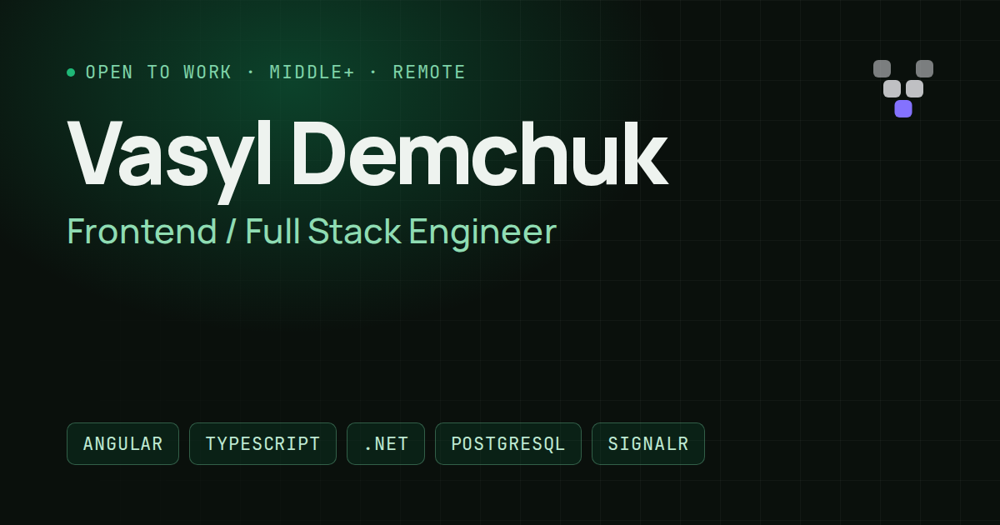

# Vadem Portfolio

Personal site of **Vasyl Demchuk**, Frontend / Full Stack Engineer (Angular, TypeScript, .NET,
PostgreSQL, SignalR). Built with Angular 22 and my own component library,
[`@vadem/ui`](https://www.npmjs.com/package/@vadem/ui).



## What's inside

- **Two prerendered languages.** `/` (English) and `/uk` (Ukrainian) are static HTML built by
  `@angular/ssr` (`outputMode: static`), then hydrated. A tiny inline script picks the visitor's
  language and theme before first paint, so there is no flash and no layout shift.
- **Live hero demo.** A small plant-monitor panel built from `@vadem/ui` charts and stats, fed by a
  simulated stream through signals. It pauses when off screen or in a background tab.
- **Tech dashboard** with brand logos from [Simple Icons](https://simpleicons.org) (CC0),
  tree-shaken to the icons in use.
- **Project case studies** with browser and phone mockups, WebP screenshots with `srcset`.
- **Certifications strip**: scroll-snap, arrow buttons, keyboard and swipe; nothing auto-plays.
- **Accessibility**: axe-clean (WCAG 2.2 AA) in dark and light themes, keyboard navigation,
  skip link, `prefers-reduced-motion` respected everywhere.

## Stack

Angular 22 (standalone, signals, OnPush, zoneless), `@angular/ssr` static prerender,
`@vadem/ui`, plain CSS on Vadem design tokens, Vitest, ESLint, GitHub Actions, Vercel.

## Structure

```text
src/app/
├── app.*              page shell: hero, experience, projects, education, contact
├── data.ts            all content (EN + UK): profile, jobs, projects, copy
├── stack.ts           tech dashboard data (logos, icons, monograms)
├── tech-dashboard.*   bento grid of technologies
├── live-demo.ts       hero "line monitor" (simulated data)
├── certs.*            certifications strip
├── cv-menu.ts         one trigger, Frontend and Full Stack CVs
├── brand-icon.ts      GitHub / LinkedIn / Telegram / npm marks
└── reveal.ts          scroll-reveal directive (one shared IntersectionObserver)
```

## Scripts

```sh
npm ci
npm start       # dev server, http://localhost:4200
npm run lint
npm test        # Vitest: content integrity, utilities, page rendering
npm run build   # prerenders / and /uk into dist/portfolio/browser
```

Content changes go to `src/app/data.ts`; tests check that both languages stay in sync and that
every screenshot and CV file referenced there exists.
